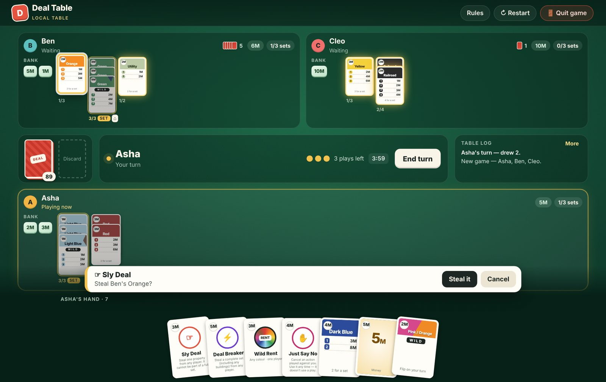
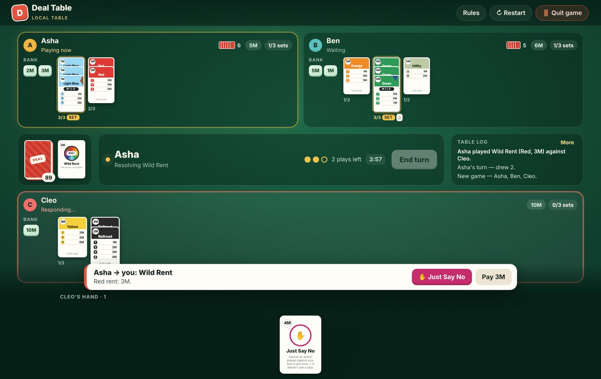
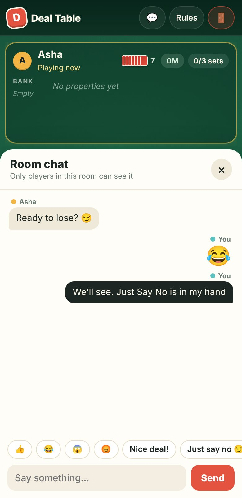

# Deal Table

A friendly digital table for **Monopoly Deal**. Play on one device by passing it around, or online with friends in a private room. It follows the official card mix and rules, with real Just Say No chains and steals you aim by tapping the table.

**▶ Play:** https://rohun-rajvanshi.github.io/deal-table/



## Features

- **Official 106-card deck**: 20 money cards, 28 properties, 11 property wilds, 13 rent cards and 34 action cards, with the real cash values.
- **Tap the table to aim**: Sly Deal, Forced Deal, Deal Breaker, rent, Debt Collector, House and Hotel all work by tapping cards, sets or players. Cards that can't be taken are dimmed.
- **Just Say No done properly**: the targeted player gets a response prompt. The attacker can counter, you can counter back, and so on. It never uses one of your 3 plays.
- **Paying debts**: pick bank cards, buildings or properties straight from your table. No change is given, and the rainbow wild can't be used to pay.
- **Two ways to play**:
  - *Same device*: a "pass to…" curtain keeps each player's hand private.
  - *Online room*: share a 6-letter code. Each player plays and answers on their own phone or computer.
- **Room chat** with quick reactions, an unread badge and message previews.
- **Restart and Leave**: the host can deal a fresh game for the same room. Anyone can leave, and you can rejoin after a refresh.
- **Works on phones**, with a bottom action bar and a fanned hand.
- **Installable app**: add it to your home screen on Android, iPhone or desktop. It opens full screen and same-device games work offline. See [docs/install-app.md](docs/install-app.md).

| Just Say No response | Online room chat (phone) |
| --- | --- |
|  |  |

## How to play

New to Monopoly Deal? Read **[docs/how-to-play.md](docs/how-to-play.md)**. It covers the rules as this table implements them and how to do each move on screen.

## How it's hosted

```
GitHub Pages  ──────────────►  Hatchable server
(this repo's public/ folder)   (online rooms + chat API, PostgreSQL)
```

- The **game itself** (`public/`) is plain HTML, CSS and JavaScript with no build step. GitHub Pages serves it straight from this repository; the top-level `index.html` forwards visitors to `public/`.
- **Online rooms and chat** need a small API and a database. On GitHub Pages, `public/config.js` points the game at the server on `https://monopoly-deal-table.hatchable.site`.
- Same-device games run entirely in the browser.

You can also run the whole thing yourself, site and API together, with Node.js and PostgreSQL. See below.

## Documentation

| Guide | What's in it |
| --- | --- |
| [How to play](docs/how-to-play.md) | Rules, cards and on-screen controls |
| [Install as an app](docs/install-app.md) | Android, iPhone and desktop install, offline play, Play Store packaging |
| [Deploy to GitHub Pages](docs/deploy-github-pages.md) | Publish this repo as a website |
| [Self-host (Azure, Docker, any Node host)](docs/self-hosting.md) | Run the site and API on your own server |
| [Architecture](docs/architecture.md) | How the code, game state and online sync work |
| [Developing](docs/developing.md) | Running locally and making changes |

## Quick start (run everything locally)

```bash
docker compose up        # app + PostgreSQL, then open http://localhost:8080
```

Or, without Docker, with Node.js 18+ and a PostgreSQL database:

```bash
npm install
cp .env.example .env     # set DATABASE_URL
npm start                # http://localhost:3000
```

## Project layout

```
index.html         Forwards GitHub Pages visitors to public/
public/            The game (index.html, app.js, table.css, config.js) and app files (manifest, sw.js, icons)
api/rooms.js       Online rooms: create, join, start, save moves, leave
api/chat.js        Room chat
lib/db.js          PostgreSQL connection
migrations/        Database tables (applied automatically on start)
server.js          Small Node server for self-hosting
docs/              Documentation and screenshots
```

---

Unofficial fan-made project. Monopoly and Monopoly Deal are trademarks of Hasbro. This project isn't affiliated with or endorsed by Hasbro.
